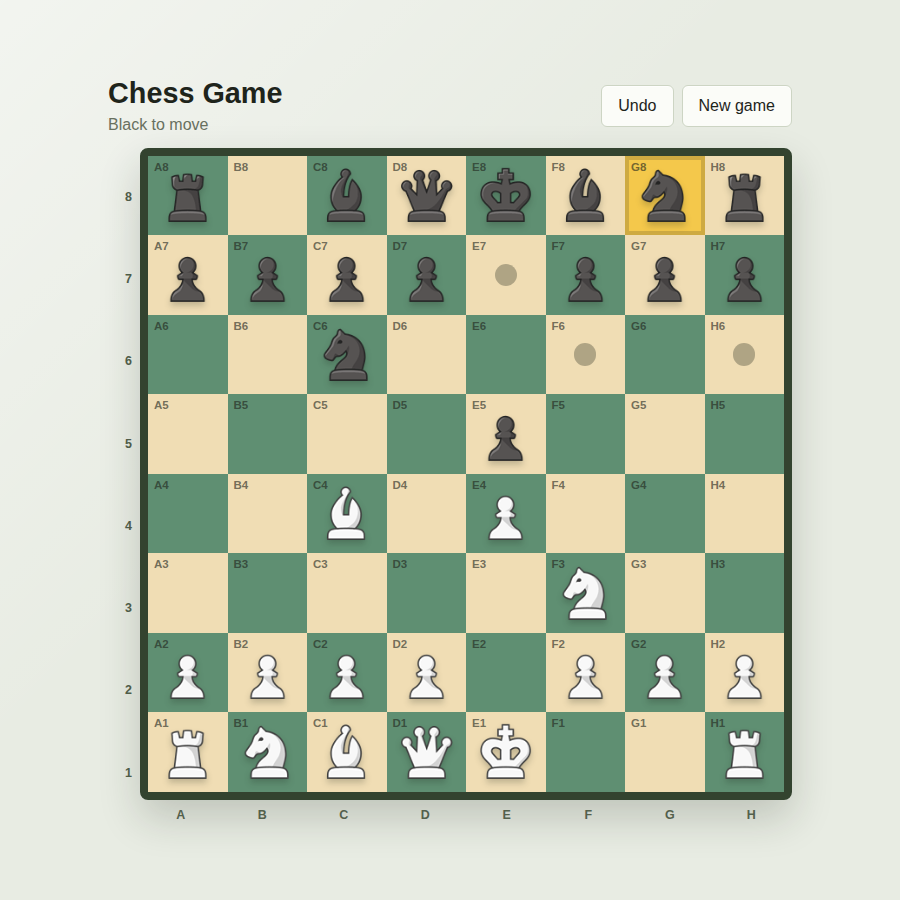
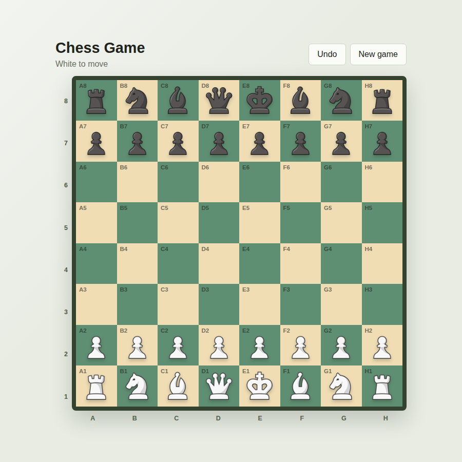
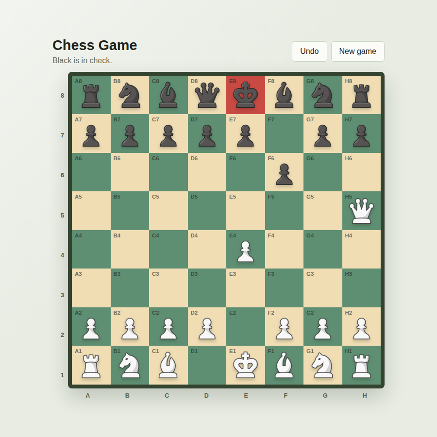
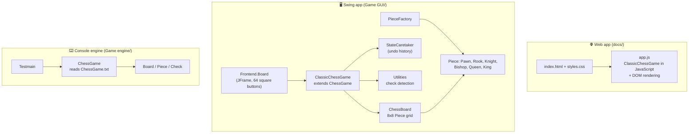

<div align="center">

# ♟️ Chess Game

**A complete chess game in three forms: play it in your browser, in a Java Swing desktop app, or run the original console engine**

[](https://youssefmohattia.github.io/Chess-game/)
<!-- TODO: confirm GitHub Pages is enabled (Settings > Pages) and the link above opens the game -->

[](https://openjdk.org/)
[](https://developer.mozilla.org/docs/Web/JavaScript)
[](https://developer.mozilla.org/docs/Web/HTML)
[](https://developer.mozilla.org/docs/Web/CSS)
[](https://docs.oracle.com/javase/tutorial/uiswing/)
[](https://maven.apache.org/)

</div>

<p align="center">
  
</p>

---

## 📖 Table of Contents

- [About This Project](#-about-this-project)
- [Features](#-features)
- [Screenshots](#-screenshots)
- [Design Patterns](#-design-patterns)
- [Architecture](#-architecture)
- [Getting Started](#-getting-started)
- [Project Structure](#-project-structure)
- [What Changed in the Update](#-what-changed-in-the-update)
- [Known Limitations](#-known-limitations)
- [What I Learned](#-what-i-learned)
- [Credits](#-credits)

---

## 🕰️ About This Project

This began as a **university project several years ago** (a Programming 2 lab series): first a console chess engine, then a Java Swing GUI on top of a chess backend, using object-oriented design and design patterns.

I recently **brought it back to life**:

- ⬆️ **Updated to the latest Java**: Maven build configured for **Java 25**, current compiler and test plugins, and a clean project layout
- 🌐 **Added a web version** that runs in any browser, with no install, build step, or dependencies, and is deployable on GitHub Pages
- 🐞 **Fixed rule and GUI bugs** found while modernizing it (details [below](#-what-changed-in-the-update))

---

## ✨ Features

| Feature | 🌐 Web | 🖥️ Swing | ⌨️ Console |
|---|:---:|:---:|:---:|
| Click a piece, then a square to move | ✅ | ✅ | ❌ (moves come from a file) |
| Legal moves highlighted | ✅ | ✅ | ❌ |
| King highlighted when in check | ✅ | ✅ | text message |
| Pawn promotion choice (Queen, Rook, Bishop, Knight) | ✅ | ✅ | ✅ |
| Undo | ✅ | ✅ | ❌ |
| New game button | ✅ | ❌ | ❌ |
| Status line (whose turn, check, result) | ✅ | ❌ | text output |
| Game-over dialog (checkmate, stalemate, draw) | ✅ | ✅ | text output |
| Responsive layout (phone and desktop) | ✅ | ❌ | ❌ |
| En passant | ✅ | ✅ | ❌ |
| Castling | ✅ | ✅ | ✅ |

### Chess rules covered

- Correct movement for all six piece types, with turn alternation
- Moves that would leave your own king in check are rejected
- **Castling**: both sides, only if the king and that rook haven't moved and the rook is present; not through an attacked square
- **En passant**, **pawn promotion**, **check**, **checkmate**
- **Draws** by **stalemate** and by **insufficient material**

---

## 📸 Screenshots

<table>
  <tr>
    <td align="center"><br/><sub>Starting position</sub></td>
    <td align="center"><br/><sub>Check: the king's square turns red</sub></td>
  </tr>
</table>

<!-- TODO (optional): add a screenshot of the Swing app, e.g. screenshots/swing.png -->

---

## 🧩 Design Patterns

The Java backend (`ChessCore`) is organized around classic design patterns, each documented with a UML class diagram.

| Pattern | Where | Purpose |
|---|---|---|
| **Factory** | `PieceFactory.createPiece(type, owner)` | Builds pieces for the starting position and for pawn promotion |
| **Memento** | `ChessBoard` (memento), `StateCaretaker` (caretaker), `ChessGame` (originator) | Stores a board snapshot after each move, which powers **Undo** |
| **Observer** | `Observer` interface, `ChessBoard.addObserver / notifyObservers`, `ChessGame` implements `Observer` | Lets the board notify listeners when a square changes (no listener is registered by default) |
| **Singleton** | `ClassicBoardInitializer.getInstance()` | One shared initializer for the standard starting layout |
| **Template Method** | abstract `ChessGame` with `isValidMoveCore()`, implemented by `ClassicChessGame` | Shared game flow, with the rule variant supplied by a subclass |

<details>
<summary><b>📐 View the UML class diagrams</b></summary>

**Factory**
<p align="center"></p>

**Memento**
<p align="center"></p>

**Observer**
<p align="center"></p>

</details>

---

## 🏗️ Architecture



- The **web version** is a JavaScript port of the Java `ClassicChessGame`. It keeps the same rule logic and method names, and adds a small DOM layer for the board, dialogs, and status text. Undo restores a full snapshot of the position, including turn, castling rights, and game status.
- The **Swing app** keeps the UI (`Frontend`) separate from the game logic (`ChessCore`). The backend has no dependency on the GUI, so it can be tested without a window.
- The **console engine** is the original standalone implementation.

---

## 🚀 Getting Started

### 🌐 Play in the browser

Open the live version: **[youssefmohattia.github.io/Chess-game](https://youssefmohattia.github.io/Chess-game/)**

Or run it locally. There is nothing to install or build:

```bash
git clone https://github.com/YoussefMohAttia/Chess-game.git
cd Chess-game/docs
# open index.html in your browser
```

**How to play:** click a piece to see its legal moves (dots), click a destination square to move. Choose a piece when a pawn promotes. Use **Undo** to take back a move, or **New game** to restart.

### 🖥️ Run the Swing desktop app

**Prerequisites:** a JDK (the project targets **Java 25**; the code also compiles on JDK 21) and optionally Maven.

```bash
cd "Chess-game/Game GUI"

# With Maven
mvn compile exec:java

# Or with plain javac
javac -d out $(find src/main/java -name "*.java")
java -cp out Frontend.Board
```

> Run from the `Game GUI` folder: the piece images are loaded from `src/main/java/Frontend/` relative to the working directory.

On Windows PowerShell, compile with:

```powershell
javac -d out (Get-ChildItem -Recurse src/main/java -Filter *.java).FullName
```

### ⌨️ Run the console engine

The engine replays a game from a text file, validating every move.

```bash
cd "Chess-game/Game engine/New folder/EngineCore"
javac -d out src/main/java/chesscore/*.java
java -cp out chesscore.Testmain
```

Run it from the `EngineCore` folder so `ChessGame.txt` is found. Each line is one move as `from,to` (for example `e2,e4`). A promotion adds the piece letter: `a7,a8,Q` (`Q`, `R`, `B`, or `K` for Knight). The engine prints events such as `Captured PAWN`, `Castle`, `White in check`, `Invalid move`, `Stalemate`, and `White Won` / `Black Won`.

### ✅ Run the backend rule checks

```bash
cd "Chess-game/Game GUI"
javac -d out $(find src/main/java src/test/java -name "*.java")
java -cp out ChessCore.BackendRuleCheck
```

`BackendRuleCheck` verifies three rules: a pawn can't promote without a chosen piece, Black pawn promotion is detected, and castling is rejected when the rook is missing. It exits silently on success and throws an `AssertionError` on failure.

---

## 📁 Project Structure

```
Chess-game/
├── index.html                       # Redirects to the web app (docs/)
├── docs/                            # 🌐 Web app (served by GitHub Pages)
│   ├── index.html
│   ├── styles.css
│   ├── app.js                       # Game logic + UI (vanilla JavaScript)
│   └── assets/                      # 12 piece images
├── Game GUI/                        # 🖥️ Swing app (Maven, Java 25)
│   ├── pom.xml
│   ├── factory.jpeg, memento.PNG, obsv.PNG   # UML diagrams
│   └── src/
│       ├── main/java/
│       │   ├── ChessCore/           # Backend: game logic + design patterns
│       │   │   └── Pieces/          # Piece classes and PieceFactory
│       │   └── Frontend/            # Board.java (Swing UI) + piece images
│       └── test/java/ChessCore/BackendRuleCheck.java
├── Game engine/
│   └── New folder/EngineCore/       # ⌨️ Console engine (Maven, Java 25)
│       ├── pom.xml
│       ├── ChessGame.txt            # Sample game (112 moves)
│       └── src/main/java/chesscore/
└── screenshots/                     # Images used in this README
```

---

## 🔄 What Changed in the Update

**Modernization**
- Maven builds target **Java 25** with updated compiler and test plugins, and correct main classes (`Frontend.Board`, `chesscore.Testmain`)
- Project layout cleaned up and renamed (`chess-gui`, `chess-engine-core`)
- The backend no longer imports the GUI, giving a one-way dependency: UI → logic

**New: web version**
- Rewrote the game logic in JavaScript and built a responsive UI with HTML and CSS: legal-move dots, check highlighting, native `<dialog>` popups for promotion and game over, a status line, Undo, and New game

## ⚠️ Known Limitations

- No threefold repetition, fifty-move rule, clocks, or computer opponent
- The console engine does not support en passant, replays moves from a file only, and prints the board as a text grid

---

## 🎓 What I Learned

- **Reviving legacy code:** upgrading a multi-year-old Java project to the latest JDK, build plugins, and layout
- **Porting between languages:** translating an object-oriented Java backend into idiomatic JavaScript while keeping the same rules
- **Separating logic from UI**, so the same game logic backs several front ends
- **Chess rules in depth:** check detection, castling restrictions, en passant, promotion, stalemate, and insufficient material
- **Design patterns in practice:** Factory, Memento, Observer, Singleton, Template Method
- Building a **responsive, dependency-free web UI** and deploying it with GitHub Pages

[GitHub](https://github.com/YoussefMohAttia) · [LinkedIn](https://www.linkedin.com/in/youssefmohattia/)
